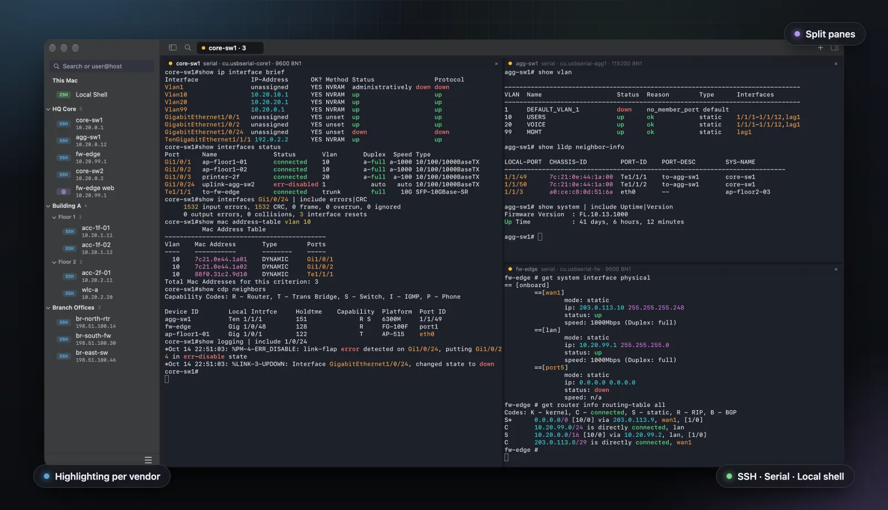
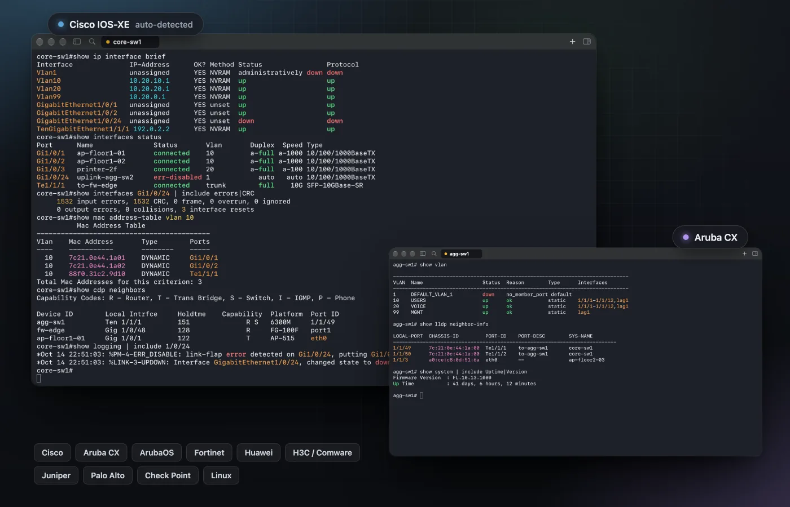
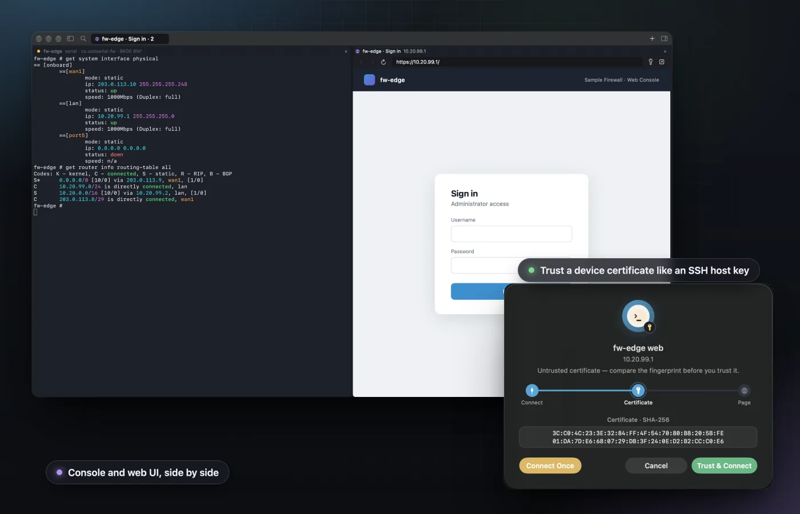
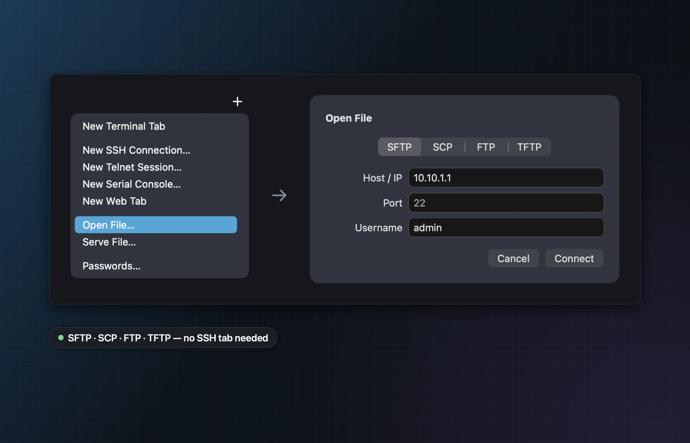
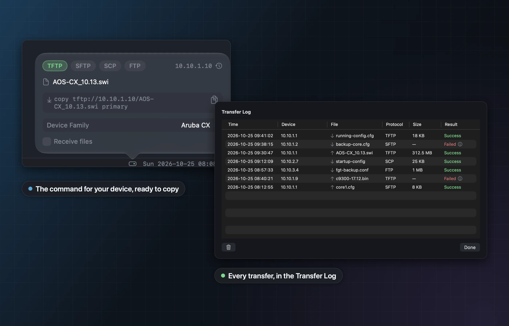
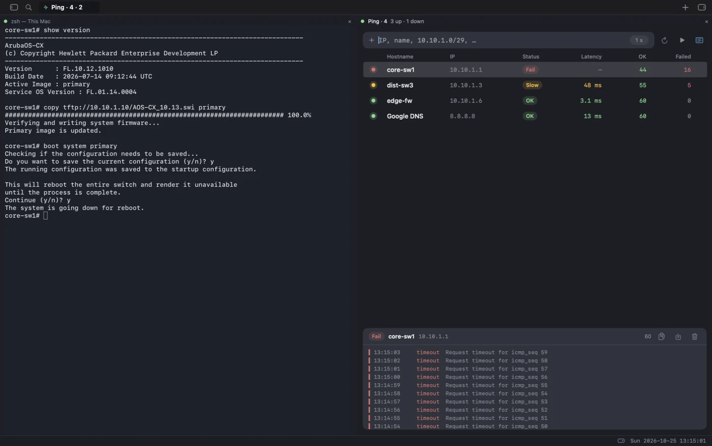
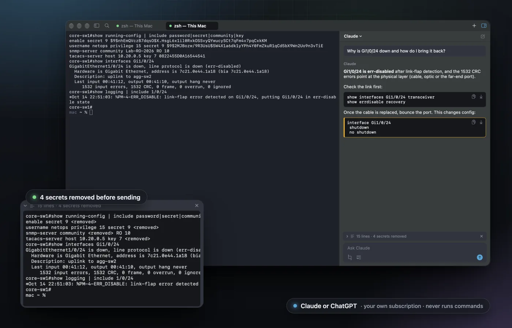
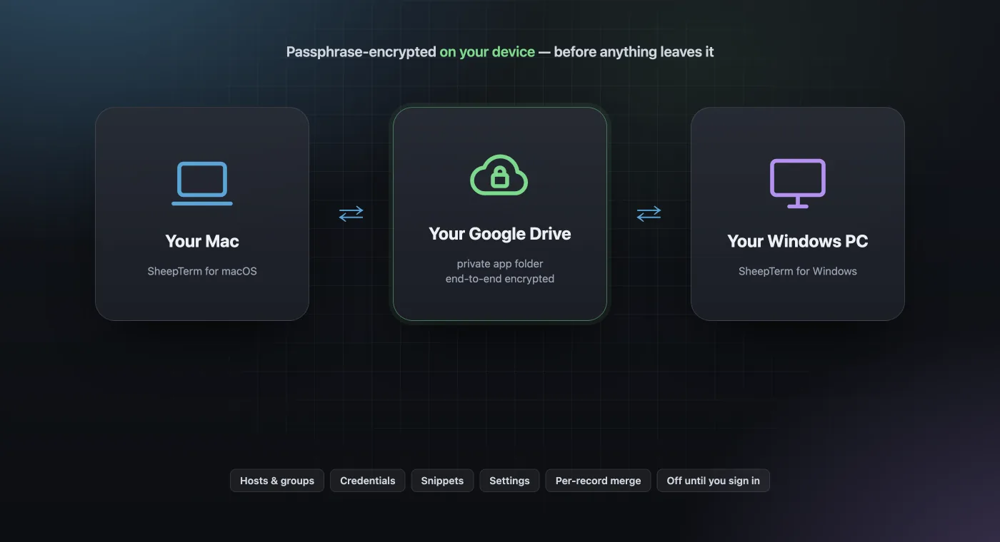
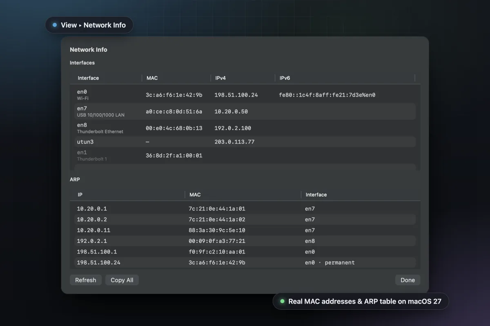
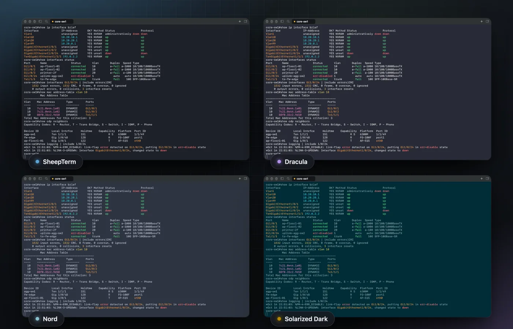

<p align="center">
  
</p>

<h1 align="center">SheepTerm</h1>

<p align="center"><b>The terminal built for network engineers.</b><br>
SSH, Telnet, serial and local shell with highlighting that knows your vendor — plus file transfer (SFTP, SCP, FTP, TFTP), SSH port forwarding, Ping, device web UIs and an AI that reads the output with you.</p>

<p align="center">本应用支持 <b>简体中文（zh-Hans）</b>，界面跟随系统语言。</p>

<p align="center">
  <a href="https://github.com/bestonehxh/SheepTerm/releases/latest/download/SheepTerm-6.0-5.dmg"></a>
  <a href="https://github.com/bestonehxh/SheepTerm-Windows/releases/latest"></a>
  <a href="https://github.com/bestonehxh/SheepTerm-Linux/releases/latest"></a>
</p>

<p align="center"><a href="https://sheepterm.com/">Website</a> · <a href="https://github.com/sponsors/bestonehxh">♥ Support SheepTerm</a> · <a href="https://github.com/bestonehxh/SheepTerm/releases">Release notes</a> · <a href="https://github.com/bestonehxh/SheepTerm-Windows">SheepTerm for Windows</a> · <a href="https://github.com/bestonehxh/SheepTerm-Linux">SheepTerm for Linux</a></p>

<p align="center"></p>

## ✨ New in 6.0

- **Open File** — browse and copy files on a device over SFTP, SCP, FTP or TFTP. From an SSH tab it rides the same connection: no second login, through a jump host too.
- **Serve File** — a TFTP / SFTP / SCP / FTP server in the bottom bar: pick the file, copy the command for your device family. Off until you start it; stops itself after 10 idle minutes; uploads never overwrite.
- **Transfer progress & Transfer Log** — percent and size in the bottom bar, Success or Failed (with the reason) after, every past transfer in one log.
- **Ping** — ping many devices at once: latency, OK / Failed, rate and a live graph per device, a packet log to copy or save as CSV; split it beside an SSH tab to watch a reload.
- **Telnet** — sessions, and `telnet://` links from GNS3 / EVE-NG.
- **Port forwarding** — local, remote and SOCKS forwards over SSH.
- **Connection status** — Wool, Packet or Sheep in the bottom bar.

## Features

<table>
<tr>
<td width="50%"><br><b>Vendor-aware highlighting</b> — Cisco, Aruba, Fortinet, Huawei, Juniper, Palo Alto and more.</td>
<td width="50%"><br><b>Device web UIs in a tab</b> — beside the console, certificates trusted like host keys.</td>
</tr>
<tr>
<td><br><b>Open File</b> — SFTP, SCP, FTP or TFTP; rides an open SSH tab.</td>
<td><br><b>Serve File &amp; Transfer Log</b> — a file server in the bottom bar, every transfer logged.</td>
</tr>
<tr>
<td colspan="2"><br><b>Ping, beside the console</b> — many hosts at once with latency, OK / Failed, rate and a last-minute graph; split it next to an SSH tab to watch a reload.</td>
</tr>
<tr>
<td><br><b>AI panel</b> — Claude or ChatGPT, your own login; secrets removed first.</td>
<td><br><b>Google Drive sync</b> — end-to-end encrypted, in your own Drive.</td>
</tr>
<tr>
<td><br><b>Network Info</b> — real MAC addresses and ARP table on macOS 27.</td>
<td><br><b>Themes &amp; fonts</b> — six themes, bundled monospace fonts.</td>
</tr>
</table>

**Also:** split panes · jump host · serial with Send Break · session logs + Search Logs · Snippets & Broadcast · safe multi-line paste · Share Link · Add Hosts from CSV · per-host command history · legacy ciphers for old gear · signed in-app updates.

## Languages

- **English** (`en`) — the source language.
- **简体中文 (Simplified Chinese, `zh-Hans`)** — the interface, menus included.

The interface follows your Mac's system language. If the system language is not supported, SheepTerm falls back to English. To switch manually, open **Settings → General → Language → App Language**, choose a language, then quit and reopen SheepTerm.

All translations live in one Xcode String Catalog (`SheepTerm/Localization/Localizable.xcstrings`) instead of separate `.strings` files. See [LOCALIZATION.md](LOCALIZATION.md) for details, including how to add another language.

## Install

**Homebrew:**

```bash
brew install --cask bestonehxh/tap/sheepterm
```

**Or manually:**

1. Download `SheepTerm-6.0-5.dmg`, open it and drag **SheepTerm** onto **Applications** (already installed? choose **Replace**).
2. Signed with Developer ID and notarized by Apple: it opens like any other app.
3. Updates are built in and verified with an Ed25519 signature.

**Requires** macOS 26.4 (Tahoe) or later, Apple Silicon. Windows 10/11 x64: [SheepTerm for Windows](https://github.com/bestonehxh/SheepTerm-Windows/releases/latest). Linux x86_64 or arm64, GTK 4: [SheepTerm for Linux](https://github.com/bestonehxh/SheepTerm-Linux/releases/latest).

## Privacy & security

- 🔑 Passwords live only in the macOS Keychain — never in files, backups or exports.
- 🛡️ New host keys and certificates are shown and confirmed before anything is sent.
- 🔒 Sync is encrypted with your passphrase before upload; nothing syncs until you sign in.
- 🤖 The AI sees only what you attach, with secrets removed, and can't run commands.
- 🍎 Own SSH and terminal emulator; crypto from macOS itself (CryptoKit, CommonCrypto, Security). No tracking.

See [PRIVACY.md](PRIVACY.md) and [TERMS.md](TERMS.md).

## The Sheep family 🐑

SheepTerm is one of a few small native apps for network engineers:

|  | App | What it does | macOS | Windows | Linux |
|---|---|---|:---:|:---:|:---:|
|  | **[SheepTerm](https://github.com/bestonehxh/SheepTerm)** | SSH / Serial / local-shell terminal for network engineers | [⬇️ Download](https://github.com/bestonehxh/SheepTerm/releases/latest/download/SheepTerm-6.0-5.dmg) | [⬇️ Download](https://github.com/bestonehxh/SheepTerm-Windows/releases/latest) | [⬇️ Download](https://github.com/bestonehxh/SheepTerm-Linux/releases/latest) |
|  | **[SheepText](https://github.com/bestonehxh/SheepText)** | Fast text editor with tree-sitter highlighting and a JavaScript plugin system | [⬇️ Download](https://github.com/bestonehxh/SheepText/releases/latest) | Coming Soon | Coming Soon |
|  | **[SheepDrop](https://github.com/bestonehxh/SheepDrop)** | SFTP / SCP / FTP / TFTP file transfer — client and built-in server | [⬇️ Download](https://github.com/bestonehxh/SheepDrop/releases/latest) | Coming Soon | Coming Soon |
|  | **[SheepTap](https://github.com/bestonehxh/SheepTap)** | Menu-bar viewer for your Mac's network interfaces with click-to-copy | [⬇️ Download](https://github.com/bestonehxh/SheepTap/releases/latest) | Coming Soon | Coming Soon |
|  | **[SheepPing](https://github.com/bestonehxh/SheepPing)** | Continuous multi-host ping monitor with per-host logs and CSV export | [⬇️ Download](https://github.com/bestonehxh/SheepPing/releases/latest) | Coming Soon | Coming Soon |

## The Lab family 🧪

The servers and hypervisor control a network lab needs, native on the Mac:

|  | App | What it does | macOS | Windows | Linux |
|---|---|---|:---:|:---:|:---:|
|  | **[LabDC](https://github.com/bestonehxh/LabDC)** | Active Directory–compatible domain controller with RADIUS for 802.1X and a lab CA | [⬇️ Download](https://github.com/bestonehxh/LabDC/releases/latest) | Coming Soon | Coming Soon |
|  | **[LabDock](https://github.com/bestonehxh/LabDock)** | VM control and console for standalone ESXi hosts — power, snapshots, guest files and scripts, no vCenter | [⬇️ Download](https://github.com/bestonehxh/LabDock/releases/latest) | Coming Soon | Coming Soon |

## Building

```bash
xcodebuild -project SheepTerm.xcodeproj -scheme SheepTerm -configuration Release build
```

Links only Apple frameworks and the local packages in `Packages/`. Needs Xcode 26+.

## License

[MIT](LICENSE) © 2026 bestonehxh
