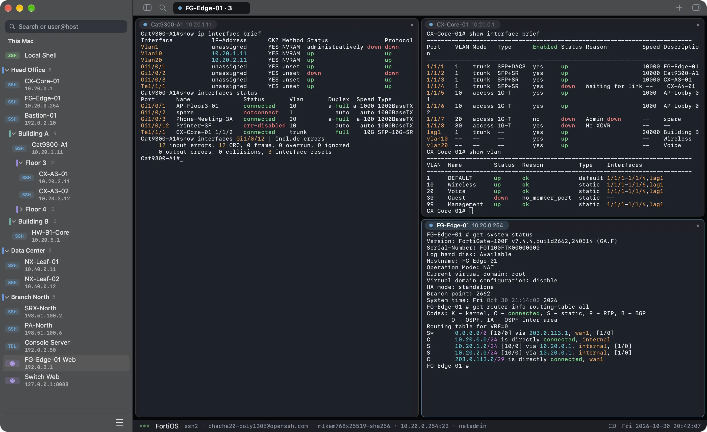
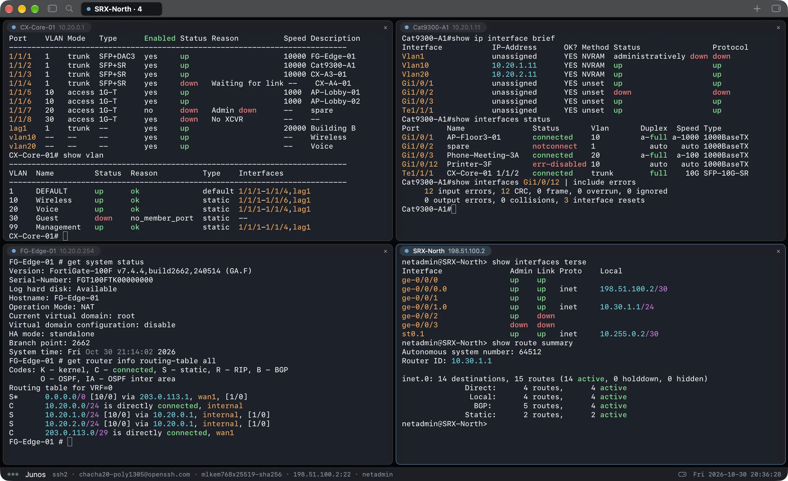
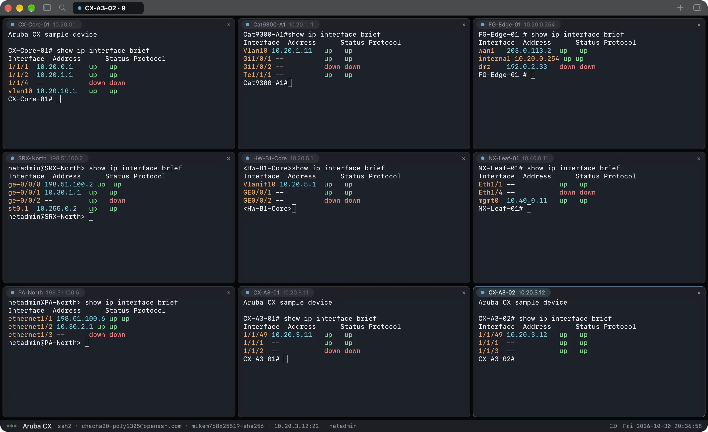
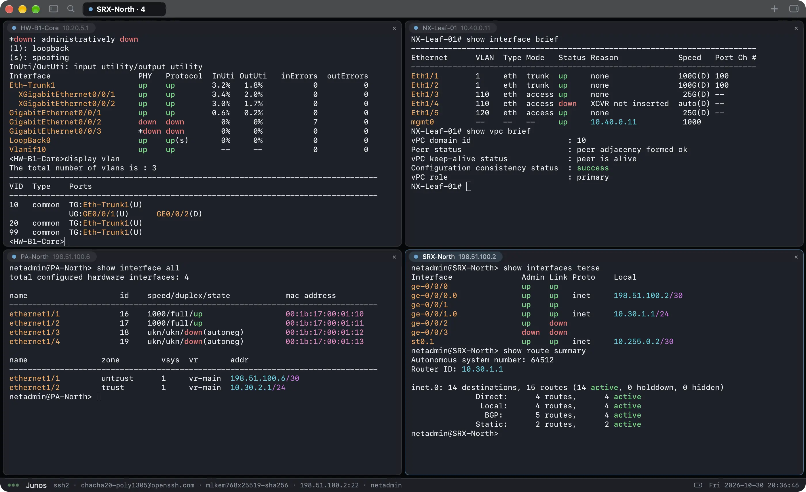
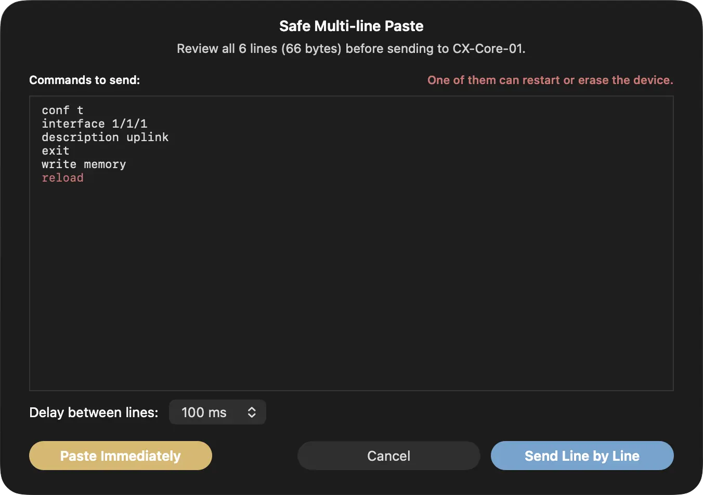
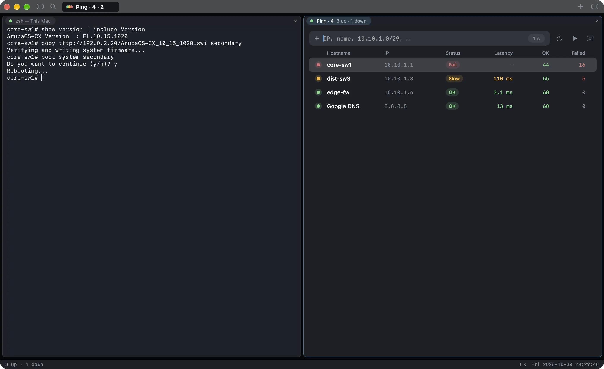
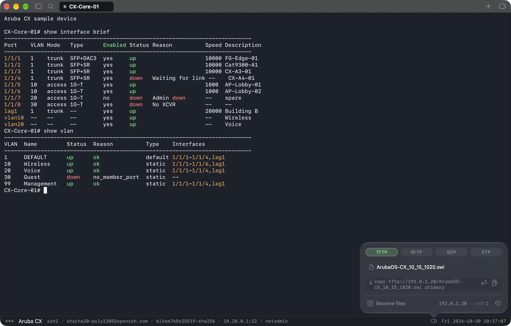
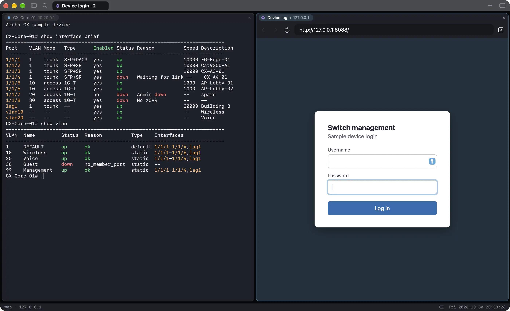
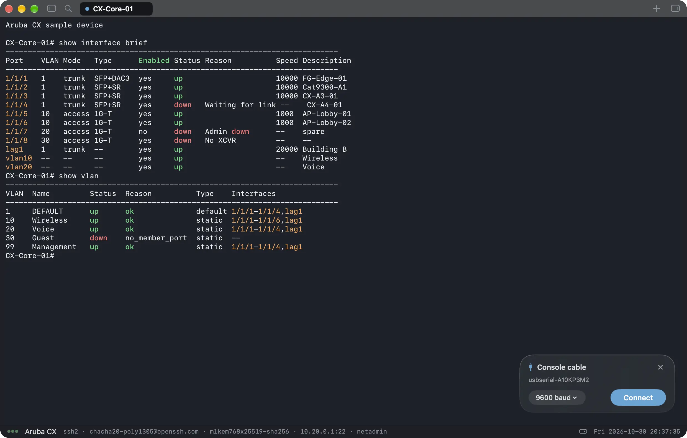

<p align="center">
  
</p>

<h1 align="center">SheepTerm</h1>

<p align="center"><b>The terminal built for network engineers.</b><br>
SSH, Telnet, serial and local shell with highlighting that knows your vendor — plus file transfer (SFTP, SCP, FTP, TFTP), SSH port forwarding, Ping, device web UIs and an AI that reads the output with you.</p>

<p align="center">English · 简体中文 · 日本語 · 한국어 · Español · Português (Brasil) · Français · Deutsch · Русский</p>

<p align="center">
  <a href="https://github.com/bestonehxh/SheepTerm/releases/latest/download/SheepTerm-6.0-17.dmg"></a>
  <a href="https://github.com/bestonehxh/SheepTerm-Windows/releases/latest"></a>
  <a href="https://github.com/bestonehxh/SheepTerm-Linux/releases/latest"></a>
</p>

<p align="center"><a href="https://sheepterm.com/">Website</a> · <a href="https://sheepterm.com/features/">All features</a> · <a href="https://github.com/sponsors/bestonehxh">♥ Support SheepTerm</a> · <a href="https://github.com/bestonehxh/SheepTerm/releases">Release notes</a> · <a href="https://github.com/bestonehxh/SheepTerm-Windows">SheepTerm for Windows</a> · <a href="https://github.com/bestonehxh/SheepTerm-Linux">SheepTerm for Linux</a></p>

<p align="center"></p>

## Features

The short version, by area. Every feature is on [sheepterm.com/features](https://sheepterm.com/features/).

### Connections

SSH, serial, Telnet and a local shell, each in its own tab. One box takes `user@host`, a URL, `ping 10.0.0.1` or `sftp://…`, and `ssh://` / `telnet://` links from GNS3 or EVE-NG open a tab. Sign-in happens on a card inside the tab; jump host, local / remote / SOCKS port forwards, auto-reconnect and legacy ciphers for old gear are built in.

### Sidebar & groups

Groups inside groups (a site, a building, a floor) in one searchable sidebar. Drag to reorder. Each host keeps its own device family, credential, logging and paging choice.

### Tabs & split panes

Up to nine panes in one tab, in a tidy grid, every pane a full session. Drag a pane header or a tab chip to move or merge; zoom a pane, even them out, or unsplit it back to a tab.

<table>
<tr>
<td width="50%"></td>
<td width="50%"></td>
</tr>
</table>

### Terminal

Our own emulator with one highlight pack per device family: Cisco, Aruba, Huawei, H3C / HPE, Juniper, Palo Alto, Fortinet, Check Point and Linux. The family is detected from the stream or set per host, and a device's own colours are never overridden.

<p align="center"></p>

**Safe Multi-line Paste** previews a paste and sends it line by line, waiting for the device's prompt. **Danger Command Guard** holds `reload`, `write erase` and the like until you press Send. Also: session logs with Search Logs, Auto-page, six themes, bundled monospace fonts and Network Info with the ARP table.

<p align="center"></p>

### Ping tab

Many hosts at once, in a tab or split beside the console while a device reloads: Status, latency, OK / Failed, rate, a last-minute graph and a packet log to save as CSV. Nothing pings until you add a target.

<p align="center"></p>

### File Server & Files tab

TFTP, SFTP, SCP and FTP servers in the bottom bar, off until you start them: pick a file and copy the command for your device family. The Files tab browses a device over SFTP, SCP, FTP or TFTP and rides an open SSH tab: no second login, through a jump host too.

<p align="center"></p>

### Web tabs & login key

A device's web page in a tab or pane, next to its console. Self-signed certificates are confirmed like host keys. A key inside the login field fills a saved credential; nothing is submitted for you.

<p align="center"></p>

### Snippets, Broadcast, Command History

Saved commands with `{{variables}}`, one line typed into every tab you tick, and each host's own history of up to 500 commands with secrets filtered out.

### Sync & security

Passwords stay in the macOS Keychain. Sign in with Google to sync hosts, groups, credentials, snippets and settings between Mac and Windows, end-to-end encrypted with your passphrase, in your own Drive. Off until you sign in.

### AI panel

Ask about the output in front of you with the Claude, ChatGPT or Gemini subscription you already have, through the vendors' own CLIs. Secrets are removed first, you can see exactly what is sent, and it never runs a command.

### Console cable

Plug in a USB console cable and a card offers Connect at the right speed. The speed is a menu on the open port, wrong-speed text gets a *Garbled? Try 115200* hint, and Send Break and XMODEM / YMODEM are there for a recovery.

<p align="center"></p>

### Backup, import & export

Add Hosts from a spreadsheet or CSV, one Backup file (never with passwords), `.sheepterm` group files, and Share Link: a group sealed with a passphrase, kept in your own Drive.

### What's New & updates

Updates are checked against an Ed25519 signature and install only when you press the button. What's New opens once per release, and any time from the menu.

## Shortcuts

| Action | Keys |
|---|---|
| Quick Connect | ⌘K |
| New Terminal Tab | ⌘T |
| New SSH Connection | ⇧⌘N |
| Split Right / Split Down | ⌘D / ⇧⌘D |
| Close Pane / Close Tab | ⌘W / ⇧⌘W |
| Next / Previous Tab | ⇧⌘] / ⇧⌘[ |
| Tab 1 to Tab 9 | ⌘1 to ⌘9 |
| Find | ⌘F |
| Toggle Sidebar | ⌘0 |
| Command History | ⌘Y |

No bare ⌃ letter belongs to the app: ⌃A, ⌃R, ⌃W and the rest reach the shell or the device CLI, and ⌥ works as Meta. [Every shortcut, Mac and Windows](https://sheepterm.com/features/#shortcuts).

## Languages

Nine languages on both Mac and Windows: English, 简体中文, 日本語, 한국어, Español, Português (Brasil), Français, Deutsch and Русский.

The interface follows your Mac's system language. If the system language is not supported, SheepTerm falls back to English. To switch manually, open **Settings → General → Language → App Language**, choose a language, then quit and reopen SheepTerm.

All translations live in one Xcode String Catalog (`SheepTerm/Localization/Localizable.xcstrings`) instead of separate `.strings` files. See [LOCALIZATION.md](LOCALIZATION.md) for details, including how to add another language.

## Install

**Homebrew:**

```bash
brew install --cask bestonehxh/tap/sheepterm
```

**Or manually:**

1. Download `SheepTerm-6.0-17.dmg`, open it and drag **SheepTerm** onto **Applications** (already installed? choose **Replace**).
2. Signed with Developer ID and notarized by Apple: it opens like any other app.
3. Updates are built in and verified with an Ed25519 signature.

**Requires** macOS 26.4 (Tahoe) or later, Apple Silicon. Windows 10/11 x64: [SheepTerm for Windows](https://github.com/bestonehxh/SheepTerm-Windows/releases/latest). Linux x86_64 or arm64, GTK 4: [SheepTerm for Linux](https://github.com/bestonehxh/SheepTerm-Linux/releases/latest).

## Privacy & security

- 🔑 Passwords live only in the macOS Keychain — never in files, backups or exports.
- 🛡️ New host keys and certificates are shown and confirmed before anything is sent.
- 🔒 Sync is encrypted with your passphrase before upload; nothing syncs until you sign in.
- 🤖 The AI sees only what you attach, with secrets removed, and can't run commands.
- 🍎 Own SSH and terminal emulator; crypto from macOS itself (CryptoKit, CommonCrypto, Security). No tracking.

See [PRIVACY.md](PRIVACY.md) and [TERMS.md](TERMS.md).

## The Sheep family 🐑

SheepTerm is one of a few small native apps for network engineers:

|  | App | What it does | macOS | Windows | Linux |
|---|---|---|:---:|:---:|:---:|
|  | **[SheepTerm](https://github.com/bestonehxh/SheepTerm)** | SSH / Serial / local-shell terminal for network engineers | [⬇️ Download](https://github.com/bestonehxh/SheepTerm/releases/latest/download/SheepTerm-6.0-17.dmg) | [⬇️ Download](https://github.com/bestonehxh/SheepTerm-Windows/releases/latest) | [⬇️ Download](https://github.com/bestonehxh/SheepTerm-Linux/releases/latest) |
|  | **[SheepText](https://github.com/bestonehxh/SheepText)** | Fast text editor with tree-sitter highlighting and a JavaScript plugin system | [⬇️ Download](https://github.com/bestonehxh/SheepText/releases/latest) | Coming Soon | Coming Soon |
|  | **[SheepDrop](https://github.com/bestonehxh/SheepDrop)** | SFTP / SCP / FTP / TFTP file transfer — client and built-in server | [⬇️ Download](https://github.com/bestonehxh/SheepDrop/releases/latest) | Coming Soon | Coming Soon |
|  | **[SheepTap](https://github.com/bestonehxh/SheepTap)** | Menu-bar viewer for your Mac's network interfaces with click-to-copy | [⬇️ Download](https://github.com/bestonehxh/SheepTap/releases/latest) | Coming Soon | Coming Soon |
|  | **[SheepPing](https://github.com/bestonehxh/SheepPing)** | Continuous multi-host ping monitor with per-host logs and CSV export | [⬇️ Download](https://github.com/bestonehxh/SheepPing/releases/latest) | Coming Soon | Coming Soon |

## The Lab family 🧪

The servers and hypervisor control a network lab needs, native on the Mac:

|  | App | What it does | macOS | Windows | Linux |
|---|---|---|:---:|:---:|:---:|
|  | **[LabDC](https://github.com/bestonehxh/LabDC)** | Active Directory–compatible domain controller with RADIUS for 802.1X and a lab CA | [⬇️ Download](https://github.com/bestonehxh/LabDC/releases/latest) | Coming Soon | Coming Soon |
|  | **[LabDock](https://github.com/bestonehxh/LabDock)** | VM control and console for standalone ESXi hosts — power, snapshots, guest files and scripts, no vCenter | [⬇️ Download](https://github.com/bestonehxh/LabDock/releases/latest) | Coming Soon | Coming Soon |

## Building

```bash
xcodebuild -project SheepTerm.xcodeproj -scheme SheepTerm -configuration Release build
```

Links only Apple frameworks and the local packages in `Packages/`. Needs Xcode 26+.

## License

[MIT](LICENSE) © 2026 bestonehxh
